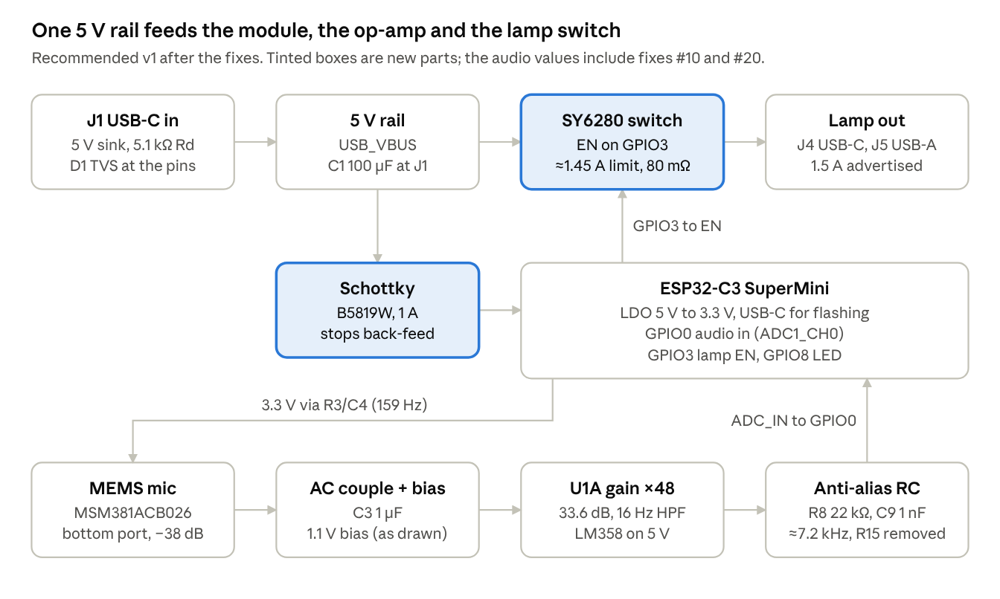
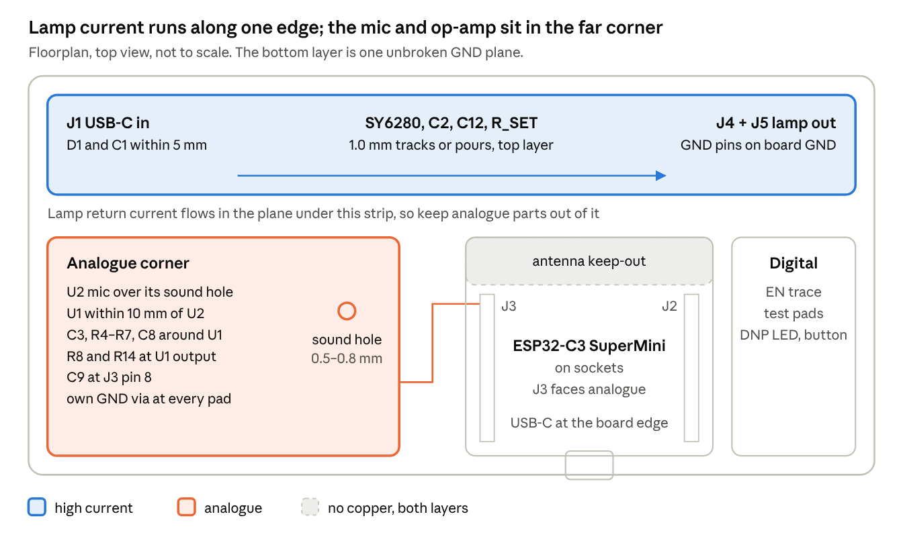
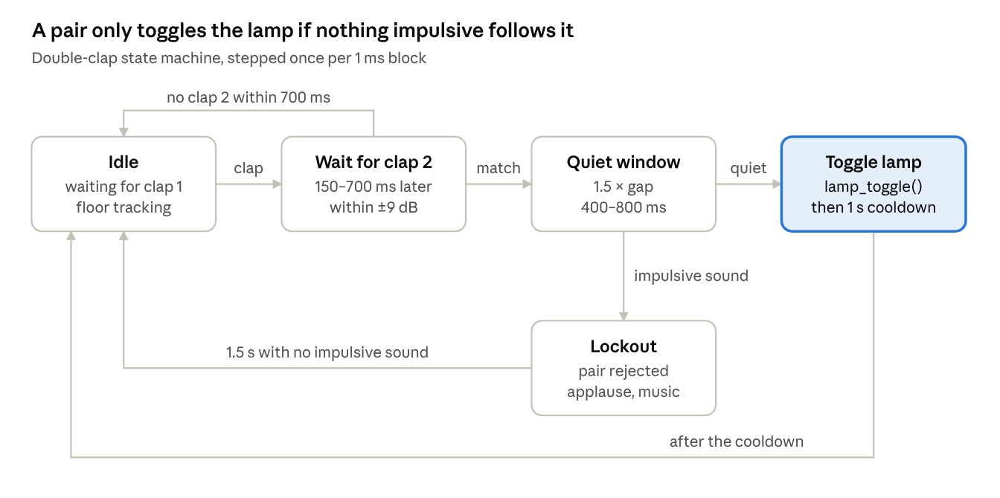
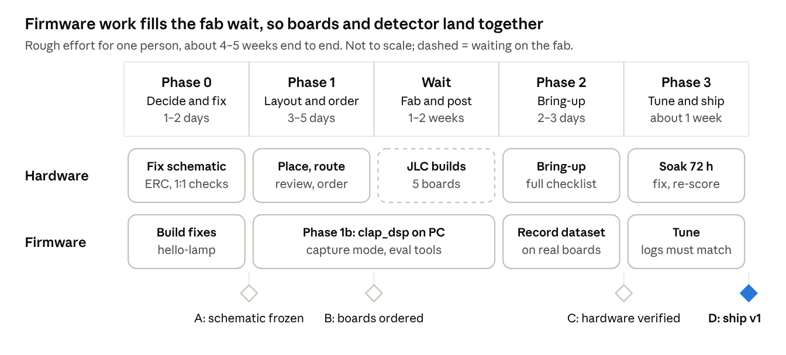

# Azura v1 — Design Doc & Plan of Action

> Snapshot of the living design doc, exported 20 Oct 2026. The Claude Doc is the source of truth:
> https://claude.ai/code/artifact/4a4da1dd-c438-40f9-902a-6cf1cc44eeb8 (private to the owner).


Oct 20, 2026 · @Joe Gould

## Summary

Azura v1 is close, but it is not ready for layout or for a first firmware build. The schematic has two errors that would stop the board working, plus a back-feed hazard and two parts to check. The firmware has four errors that stop it compiling. The plan below fixes those first, then lays out the PCB while the clap detector is developed and tested on a PC.

**Where it stands (20 Oct 2026).** The [azura\_v1 repo](https://github.com/JoeGould1878/azura_v1) has two commits: the `adc_sampler` component (16 kHz continuous ADC with DMA) and an empty `main.c`. The schematic is complete on one sheet: 40 parts, SMD footprints and LCSC numbers filled in, no PCB yet. I extracted the netlist from the `.kicad_sch` with a script rather than reading it by eye (Appendix).

**Must fix before layout**

1. **D1 (SMAJ5.0A) is fitted backwards.** It uses KiCad's bidirectional TVS symbol, so footprint pad 1 (the cathode) lands on GND. A unidirectional TVS fitted that way is a forward-biased diode across 5 V. The board would sit in current limit at about 2.4 A and never power up.
2. **The lamp's ground is switched, and the shield bypasses the switch.** The J4/J5 GND pins connect to Q3's drain, and the same node drives Q4's gate. The connector shells go straight to board GND, though. Any lamp or cable that ties its shield to GND, which most do, shorts that node to ground. Q4 then stays on and the lamp cannot be switched off.
3. **The SuperMini's USB port back-feeds the board.** Its 5 V pin is tied straight to `USB_VBUS`. Plug the module into a PC to flash it while J1 is powered, and the PC and the charger are tied together. The lamp can then draw from the PC port. One Schottky diode fixes this.
4. **Check before placing:** the J5 footprint is the Würth 614004134726, but LCSC C428472 is a SOFNG USB-101. Also confirm the mic footprint has the sound hole that a bottom-port MEMS mic needs.

**Must fix before the firmware builds**

1. `components/adc_sampler/` has no `CMakeLists.txt`, so ESP-IDF does not see it as a component.
2. `main/main.c` is empty, so there is no `app_main`, and `main` does not require `adc_sampler`. With `MINIMAL_BUILD ON`, the sampler is never built.
3. `adc_continuous_del_handle()` does not exist in ESP-IDF v6.1. The function is `adc_continuous_deinit()`.
4. The two ISR callbacks carry `IRAM_ATTR` on both their prototypes and their definitions. Each expansion picks a different section name, and GCC rejects the clash under `-Werror=attributes`. (Confirmed by building against v6.1. I had listed a `%u` format issue here, but v6.1's log macros don't format-check, so that one is only a should-fix.)

**Decisions (20 Oct 2026).** The SY6280 load switch replaces the discrete limiter and switch. The BOM stays as small as possible: the trims in the Schematic review take the board from 40 parts to 32, and anything optional goes in as an unfitted footprint. The status LED and fallback switch are parked as unfitted footprints; until they are fitted, the firmware uses the module's own LED and BOOT button. The lamp and enclosure aren't chosen yet, so R\_SET, the fitted lamp connector and the board outline wait for them.

**On the DSP question:** yes, leaky integrators are the right tool. Two of them, a fast envelope and a slow noise floor, form a short-term/long-term ratio detector. A timing state machine on top does the double-clap logic (Double-clap DSP section).

## Requirements & assumptions

Azura v1 is a USB-C pass-through box that toggles a 5 V USB lamp on a double clap. "Shippable" here means three things: it works first time on the bench, it survives normal misuse at its connectors, and it does not false-trigger in an ordinary living room.

**Functional requirements**

1. Power in through USB-C (J1) at 5 V only, no USB-PD negotiation.
2. Power out to one lamp through USB-C (J4) or USB-A (J5), switched by the ESP32-C3. Lamp is off at power-up and after any reset.
3. A double clap toggles the lamp: two claps 150–700 ms apart, similar loudness, followed by at least 400 ms of quiet.
4. Single claps, applause (three or more claps), speech, music, TV, door slams and dropped objects do not toggle the lamp.
5. Works from roughly 0.5 m to 4 m in a typical room.
6. The smallest BOM that meets the above. Every part earns its place; optional parts go in as unfitted footprints.

**Proposed acceptance targets** (to confirm)

| Metric | Target |
| --- | --- |
| Detection, double claps at 1–3 m, quiet room | ≥ 95 % |
| Detection with TV or music at conversation level | ≥ 85 % |
| False toggles from normal household sound | ≤ 1 per 24 h (stretch: ≤ 1 per week) |
| Latency, second clap to lamp change | ≤ 600 ms for clap gaps up to 400 ms |
| Lamp current | ≤ 1 A (5 W): the SY6280's limit is ±25 %, and R\_SET = 4.7 kΩ gives 1.1–1.8 A |
| Board draw with lamp off, radio off | < 50 mA |

**Assumptions this plan rests on** — each is also an open question at the end

- The lamp isn't chosen yet. The plan assumes a 5 V lamp drawing at most 1 A (5 W); R\_SET is set once the real one is measured, and a lamp over about 1.1 A needs a different switch.
- No enclosure yet. The layout assumes an inline box: input at one end, lamp at the other, sound hole under the board.
- v1 keeps the ESP32-C3 SuperMini plug-in module on sockets, with Wi-Fi and BLE off.
- Fab and assembly at JLCPCB (the schematic carries LCSC part numbers), 2-layer, 1.6 mm, parts on the top side only. Only the lamp connector the lamp needs gets fitted.
- Firmware stays in C on ESP-IDF v6.1, in this repo.
- No certification (UKCA/CE/FCC) for v1; small batch only.

## System architecture

One 5 V rail feeds everything. The SuperMini's own regulator makes 3.3 V, and a single GPIO decides whether the lamp gets power. The audio path is mic → AC-coupled gain stage → RC filter → ADC1 channel 0. Firmware reads it with DMA in 8 ms frames.



Power runs along the top row and audio along the bottom. The module sits between them and is the only link from sound to lamp.

**ESP32-C3 SuperMini pin use** (J3 is the 5V / GND / 3V3 / GPIO4–0 row; check the order against your module)

| J3 pin | Module pin | Net | Use | Note |
| --- | --- | --- | --- | --- |
| 1 | 5V | `USB_VBUS` | Module power in | No diode: back-feed risk (must-fix 3) |
| 2 | GND | GND | — |  |
| 3 | 3V3 | `3v3_RAW` | Feeds the mic and bias rail through R3 | The module's LDO output |
| 4 | GPIO4 | — | Free, ADC1\_CH4 | Spare (VBUS monitor in v1.1) |
| 5 | GPIO3 | `DIG_OUT` | Lamp enable | Not a strapping pin. R10 holds it low through reset |
| 6 | GPIO2 | — | Free | Strapping pin: leave unloaded |
| 7 | GPIO1 | — | Free, ADC1\_CH1 | Spare (lamp detect in v1.1) |
| 8 | GPIO0 | `ADC_IN` | Audio in, ADC1\_CH0 | Matches `ADC_CHANNEL_0` in the code |

On the module itself, GPIO8 drives the blue LED (active low) and GPIO9 is the BOOT button. Both are strapping pins, but once the chip has booted, firmware can use the LED for clap feedback and the BOOT button as the fallback toggle, at no BOM cost. All of J2 (GPIO5–10, 20, 21) is unused; GPIO10 takes the optional external button footprint (#14).

## Schematic review

Five must-fix items, twelve should-fix and six nice-to-have. Updated 20 Oct with your decisions: the SY6280 is agreed, deferred items are marked, and rows 20–23 trim the BOM. Every fix is cheap now, because there is no layout yet. Set Status as you go.

The KiCad steps for all of this, in order, are in Board to-do.

| # | Severity | Area | Finding | Fix | Status |
| --- | --- | --- | --- | --- | --- |
| 1 | Must fix | Power: D1 | TVS fitted backwards. The bidirectional symbol puts the cathode (pad 1) on GND, so the SMAJ5.0A forward-conducts across 5 V | Unidirectional symbol (e.g. `Diode:SMAJ5.0A`), cathode to VBUS. Check the cathode band in JLC's placement preview | Open |
| 2 | Must fix | Output: J4, J5, Q3, Q4 | Lamp GND pins sit on Q3's drain, which also drives Q4's gate. Shells are on GND, so a shield-to-GND lamp holds Q4 on | Solved by #6: the SY6280 switches VBUS only, so the J4/J5 GND pins go straight to board GND | Agreed |
| 3 | Must fix | MCU power: J3.1 | Module 5V pin tied to `USB_VBUS`: a PC on the module's USB and a charger on J1 end up shorted together | Schottky in series, anode `USB_VBUS`, cathode J3.1 (e.g. B5819W, 1 A); the module's LDO still gets about 4.7 V. A solder jumper you open while developing costs no parts, but is easy to forget | Open |
| 4 | Must fix | Connector: J5 | Footprint is Würth 614004134726, but LCSC C428472 is a SOFNG USB-101 (THT). Pin and tab positions unverified | Compare both drawings, then change the footprint or the part. Only matters if J5 gets fitted (#23) | Open |
| 5 | Must fix | Mic: U2 | Bottom-port mic (Ø0.25 mm port) needs a hole through the PCB. The easyeda2kicad footprint may not have one | 0.5–0.8 mm NPTH on the port centre, inside the ground ring. No paste or vias near it | Open |
| 6 | Should fix | Power path | Discrete limiter and switch drop 0.62 V at 1.5 A (lamp gets 4.38 V). A soft overload puts about 2.4 W into Q2 (SOT-23) with no thermal cut-off | SY6280AAC (C55136) replaces Q1–Q4, R9, R13 and R16–R18. EN comes straight from GPIO3, with R10 as its pull-down. R\_SET 4.7 kΩ (C23162, the same part as R14) gives 1.1–1.8 A, right for lamps up to 1 A (5 W). Use 4.3 kΩ for a 5–6 W lamp; below about 3.6 kΩ the limit can exceed the SY6280's 2 A rating. C12 (10 µF) at OUT protects the 6 V-rated pin | Agreed |
| 7 | Should fix | Power: D1 and C1 | The SY6280 is rated 6 V absolute maximum on every pin, below the SMAJ5.0A's 6.4 V minimum breakdown. The TVS alone can't hold hot-plug ringing under that | D1 and C1 within 5 mm of J1's VBUS pins. Keep C1 an electrolytic, since its ESR damps the ringing. Stay with SMAJ5.0A, the lowest-voltage part in its series | Open |
| 8 | Should fix | Output: Q4 slew | Q4 switches in tens of ns, so the lamp's input cap charges from the bulk caps and can brown out the ESP32 | Not needed: the SY6280 replaces Q4 and limits turn-on current | Won't fix |
| 9 | Should fix | Analogue: bias | U1 is biased at 1.1 V in a 0–3.5 V output range, then the ×2/3 divider puts the ADC at 0.73 V. Claps above about 99 dB SPL peak (closer than \~1 m) clip | Remove R15 (#20) and keep the 1.1 V bias: the ADC sits mid-range at about 1800 codes, with the same clip point and 1.5× the resolution. Optional: R7 → 120 kΩ (1.24 V bias) for 1 dB more headroom | Open |
| 10 | Should fix | Analogue: anti-alias | The only pole is at 23.9 kHz (6.67 kΩ, 1 nF). Nyquist is 8 kHz at 16 kHz sampling | R8 10 kΩ → 22 kΩ (the same part as R11/R12), C9 stays 1 nF: 7.2 kHz once R15 is gone, with no new part. 560 pF across R5 as an unfitted footprint | Open |
| 11 | Should fix | Analogue: U1 supply | The LM358 runs from raw `USB_VBUS`, so charger ripple and PWM-dimmed lamp current feed straight into the gain stage | Footprints only: 47 Ω with a bridged solder jumper across it, and an unfitted 10 µF. Fit both if lamp-on captures show noise | Open |
| 12 | Should fix | Bring-up | No test points | Bare copper test pads, no BOM cost: J1 VBUS, `USB_VBUS`, lamp VBUS, `3v3`, op-amp out, `ADC_IN`, EN, GND | Open |
| 13 | Should fix | BOM: module | J2/J3 sockets have no LCSC part, and the SuperMini isn't in the BOM | Sockets on the first boards. Later, solder the module down and drop both | Open |
| 14 | Nice to have | UX | No manual control or feedback | Parked. Firmware uses the module's GPIO8 LED for feedback and its BOOT button (GPIO9) as the fallback toggle. Unfitted footprints on the carrier: a status LED on GPIO7 (D4, R21) and a tact switch on GPIO10 (SW1) | Open |
| 15 | Nice to have | Output: J4 | Hot source: VBUS goes on without checking that a sink is attached | Deferred to v1.1 | Won't fix |
| 16 | Nice to have | Output: J5 | Some USB-A devices draw ≤ 500 mA unless D+ is shorted to D− (BC1.2 charger signature) | Unfitted 0 Ω footprint between J5 D+ and D−, no BOM cost | Open |
| 17 | Nice to have | Diagnostics | No supply monitor | Deferred to v1.1 | Won't fix |
| 18 | Nice to have | Analogue: op-amp | The LM358's swing stops 1.5 V below its rail, and its PSRR falls with frequency | Deferred to v1.1 | Won't fix |
| 19 | Nice to have | ERC tidy | A dangling wire stub above C5. Four NC flags sit on wire stubs off J1 D+/D− rather than on the pins. Label typos "OUPTUT", "ANALOUGE" | Delete the stub, move the NC flags onto the pins, fix the labels | Open |
| 20 | Should fix | BOM: R15 | Only there to scale U1's output into the ADC range, which the drawn bias already fits | Remove R15. R14 stays: it is then the only DC load keeping the LM358 in class A | Open |
| 21 | Should fix | BOM: C6 | With the SY6280 limiting lamp inrush, one bulk cap is enough | Remove C6; keep C1 at J1 (#7) | Open |
| 22 | Should fix | BOM: D2 | The SY6280 turns off in about 10 µs at up to 2 A, so 1 µH of cable kicks the lamp port by only about 0.2 V | Keep the footprint, leave D2 unfitted. Fit it only if the bring-up short test takes the port below −0.3 V; C12 at U3's OUT pin already damps it | Open |
| 23 | Should fix | BOM: lamp connectors | Both J4 and J5 are fitted, but only one lamp is used | Keep both footprints; fit only the one the lamp needs. R11/R12 go with J4 | Open |

### BOM after these changes

The board goes from 40 parts as drawn to 32. That drops to 31 once only one lamp connector is fitted, or 29 if it's J5, since R11 and R12 go with J4.

| Change | Out | In |
| --- | --- | --- |
| SY6280 output switch (#6) | Q1–Q4, R9, R13, R16–R18 (9) | U3 SY6280, R\_SET (2) |
| Back-feed diode (#3) |  | D3 Schottky (1) |
| Divider resistor (#20) | R15 (1) |  |
| Second bulk cap (#21) | C6 (1) |  |
| Output clamp (#22) | D2 (1, footprint kept) |  |
| Lamp-port capacitor (#6) |  | C12, 10 µF (1, same part as C4) |

These footprints stay on the board unfitted, at no BOM cost: D2, the U1 RC (#11), 560 pF across R5 (#10), the GPIO7 status LED and GPIO10 button (#14), the J5 D+/D− link (#16), and the test pads (#12).

At JLC each extended part type adds a setup fee per order, so cutting unique extended parts saves more than cutting basic passives. Check which of the SY6280, mic, TVS and connectors are basic parts.

**Checked and correct**

- J1 CC1/CC2 have 5.1 kΩ Rd, so a USB-C source will turn on 5 V.
- J4 CC1/CC2 have 22 kΩ Rp to 5 V, which advertises 1.5 A.
- U1B is parked as a follower with + at GND, inside the LM358's input range.
- R14 (4.7 kΩ output pull-down) keeps the LM358 in class A and avoids crossover distortion. Keep it, all the more once R15 goes.
- Without R15, a very loud clap can drive the ADC pin towards 3.75 V. With R8 at 22 kΩ the clamp current stays under 10 µA, which is harmless, and those samples simply read full scale.
- R3/C4 give the mic a 159 Hz-filtered 3.3 V supply with a 17.5 mV drop.
- R10 holds the lamp off through reset and boot, and does the same job on the SY6280's EN.
- LCSC codes for R4, R5, R11, R15 and R16 match their values. The mic (C51928208) is in stock.

## PCB layout guide

Two layers are enough. Put a solid GND plane on the bottom, run the lamp current in a straight line along one edge, and keep the mic and op-amp in the far corner, so lamp current never flows under the analogue parts. It assumes the agreed SY6280 output switch (#6) and the BOM trims (#20–#23).



If Wi-Fi is wanted later, turn the module so its antenna end overhangs the right-hand edge instead.

### Stackup and rules

- 2 layers, 1.6 mm FR-4, 1 oz copper. Choose ENIG over HASL: it is flatter for the 0.5 mm-pitch USB-C pins and the LGA mic.
- JLC-safe DRC set before placing anything: 0.2 mm track and space, 0.3 mm drill / 0.6 mm via pad, 0.3 mm copper-to-edge.
- Net class `LAMP_5V` (J1 VBUS to J4/J5 VBUS, and the return): 1.0 mm minimum, or pours. By IPC-2221, 1.0 mm on 1 oz outer copper carries about 2.4 A at a 10 °C rise; 1.5 A needs 0.53 mm, so 1.0 mm leaves margin. Keep the power path on the top layer; where it must change layer, use at least three vias.
- Default class 0.25 mm for signals, 0.4 mm for `3v3` and the U1 supply.

### Placement, in this order

1. **Mechanical first.** With no enclosure yet, assume an inline box: board outline, J1 on one end, the J4/J5 footprints on the opposite end, mounting holes. Input and outputs at opposite ends make the power path a straight line.
2. **Power edge.** J1 → D1 and C1 within 5 mm of the VBUS pins → C2 at the SY6280's IN pin → SY6280 → C12 at its OUT pin → J4/J5, all along one long edge. The unfitted D2 footprint sits at the lamp connectors.
3. **SuperMini.** Sockets J2/J3 with the module's USB-C at a board edge, so you can flash and stream captures in place. Over the antenna end, keep both layers free of copper for its full width; this matters if Wi-Fi is ever switched on. Small passives can sit under the module (sockets give about 8.5 mm clearance), but not the analogue parts.
4. **Analogue corner,** furthest from the power edge. U2 goes where the enclosure's sound opening will be. U1 sits within 10 mm of U2, with R4–R7, C3 and C8 around it. Put R8 and R14 by U1's output, and C9 at J3 pin 8 (the ADC pin).
5. **Decoupling.** C7 at U1 pin 8, with the unfitted RC from #11 just before it. C5 within 2 mm of U2's VDD, C2 at the SY6280's IN pin.
6. **Unfitted footprints.** The GPIO10 button goes where the enclosure will let a finger reach it, and the GPIO7 LED where it can be seen. The 560 pF goes across R5, and the D+/D− link at J5.

### Ground

- The bottom layer is one unbroken GND plane: no splits, no long bottom traces. Any bottom jumper should be short, and never under U1, U2 or the ADC trace.
- Lamp return current runs J4/J5 GND → plane → J1 GND under the power edge. Keeping the analogue corner out of that strip is what keeps it quiet, rather than a split plane.
- Give each analogue part its own GND via next to its pad, not a daisy chain. Stitch top-layer GND pours to the plane every 5–10 mm and along the edges.
- Tie each USB shell leg to GND with its own vias.

### Power routing

- Join J1's four VBUS pads on the connector side, then go straight to a wide pour. Do the same at J4.
- SY6280: short pours on IN (pin 5) and OUT (pin 1). R\_SET goes right at ISET (pin 3) with its own GND via. R10 sits at EN (pin 4), and EN runs straight from GPIO3.
- At 1 A the SY6280 dissipates about 0.08 W (0.18 W at 1.5 A), which is fine in SOT-23-5 with pours.

### Analogue routing

- The most sensitive node is U2 OUT → C3 → U1 pin 3, at 66.7 kΩ. Keep it under 10 mm, flanked by GND pour, and away from `DIG_OUT`/EN.
- Keep the R5/R6/C8 feedback loop tight around U1 pins 1–3.
- Run `ADC_IN` over unbroken plane. C9 sits on J3 pin 8's pad.
- Route `DIG_OUT` to the switch along the digital side, never through the analogue corner.

### Mic port and enclosure

- With top-side-only assembly, U2 sits on top and hears through the PCB, so the bottom face must meet the enclosure's sound hole. Seal PCB to enclosure with a foam or silicone gasket ring, ideally with a mesh behind the hole.
- PCB hole: 0.5–0.8 mm NPTH centred on the port, inside the footprint's ground seal ring. No paste aperture over it, no vias within 1 mm, at least 2 mm from the board edge.
- The datasheet says no board washing after reflow. Confirm JLC's process, or hand-place U2.

### DFM for JLC

- Top-side assembly only. Hand-solder the THT parts (C1, J5 if that is the connector you fit, the sockets) or pay for JLC's THT service. An SMD electrolytic for C1 lets JLC place it too.
- Check the 3D view for heights: C1 must clear the module and the enclosure lid.
- Mark unfitted parts DNP in KiCad, so they stay out of the BOM and placement files.
- Silkscreen: "5V IN" at J1, "LAMP" at J4/J5, polarity on D1, D3, C1 and the D2 footprint, the module outline with a USB arrow, TP labels, and "Azura v1" with the date.
- Before ordering, check every rotation in JLC's placement preview. SOT-23-5, USB-C and LGA mic offsets are the usual culprits.

### Layout checklist

- [ ] Schematic fixes applied, ERC clean (zero errors, warnings explained)
- [ ] Board outline and connector positions agreed (inline-box assumption until there is an enclosure)
- [ ] JLC DRC rules and the `LAMP_5V` net class set
- [ ] Footprints checked 1:1 against datasheets: J1/J4, J5, U2 and its hole, SY6280 pin 1, D1 and D3 cathodes
- [ ] SuperMini row spacing and pin 1 measured; 1:1 printout test-fitted with the real module and connectors
- [ ] Power path placed straight along one edge; analogue corner opposite
- [ ] Bottom plane unbroken; top GND pour stitched
- [ ] Analogue routed and guarded; C9 on J3 pin 8
- [ ] Antenna keep-out under the module's antenna end
- [ ] Test pads placed and labelled; unfitted parts marked DNP
- [ ] DRC clean; 3D view checked for heights and connector overhang
- [ ] Gerbers viewed; JLC placement preview checked part by part
- [ ] Second pair of eyes runs this list before ordering

## Firmware architecture

Keep `adc_sampler`, but simplify it so one high-priority task drains the DMA pool into `int16` samples. Hand those to a clap detector written in plain C with no ESP-IDF includes. That detector compiles on a PC, so it can be tested against recorded audio long before the boards arrive. The `.gitignore` already expects `test/host/build/` and Python tooling, so this fits the direction you were taking.

### Build fixes (do first)

1. Add `components/adc_sampler/CMakeLists.txt`: `idf_component_register(SRCS "adc_sampler.c" INCLUDE_DIRS "." PRIV_REQUIRES esp_adc)`.
2. In `main/CMakeLists.txt`, swap `PRIV_REQUIRES spi_flash` (left over from hello\_world) for the Azura components, then write `app_main`.
3. Replace `adc_continuous_del_handle()` with `adc_continuous_deinit()`.
4. Put `IRAM_ATTR` on the callback definitions only, not the prototypes. Also print `uint32_t` with `"%" PRIu32`: v6.1's log macros don't check formats, so the compiler won't catch the mismatch.
5. Rename `project(hello_world)` to `project(azura)`. Add an `sdkconfig.defaults` with: console on USB-Serial-JTAG (the SuperMini has no USB-UART chip), 1000 Hz FreeRTOS tick, 160 MHz CPU, task watchdog on. Confirm the exact option names in v6.1 menuconfig.

### adc\_sampler review

I read the v6.1 driver source to check these against what the driver actually does.

| Issue | Why it matters | Fix |
| --- | --- | --- |
| `TAG` and `adc_handle` have external linkage | Any other file defining the same names fails to link | Make both `static` |
| The `.c` does not include its own `.h`, and repeats its macros | Prototypes go unchecked; values can drift apart | Include the header, delete the copies |
| Deinit calls `adc_continuous_register_event_callbacks(handle, NULL, NULL)` | v6.1 returns `ESP_ERR_INVALID_ARG` for a NULL table, so deinit exits early and leaks the handle | Pass a zeroed `adc_continuous_evt_cbs_t`, or skip the call: deinit frees everything anyway |
| One queue token per frame | The driver's ISR calls `on_conv_done` even when its ring-buffer push failed. After an overflow, tokens point at frames that no longer exist | Use a task notification as a wake-up hint, then drain `adc_continuous_read(…, 0)` until `ESP_ERR_TIMEOUT` (Espressif's example pattern) |
| A short read is treated as `ESP_FAIL` and discarded | The read uses `xRingbufferReceiveUpTo`, which legitimately returns less at the buffer's wrap point | Accept any multiple of 4 bytes and process it |
| 1024-byte pool | 4 frames of 64 samples, 16 ms: any stall longer than that (console output with no host attached, a flash write) drops audio | 4096–8192 bytes (64–128 ms), and keep logging out of the audio task |
| `.format = …` | Deprecated in v6.1; the C3 has one fixed output format | Delete it |
| `pdTICKS_TO_MS(portMAX_DELAY)` | Overflows to a garbage timeout | Map `portMAX_DELAY` to `ADC_MAX_DELAY` |
| `ESP_LOGE` on every timeout | Floods the console at 250 frames/s | Count errors in a stats struct; log a summary every few seconds |
| Init failures return without cleanup | The handle leaks on a half-built driver | One cleanup path that stops and deinits |

Each C3 conversion result is 4 bytes (`adc_digi_output_data_t.type2`: 12-bit data, 3-bit channel, unit bit). Check channel 0 / unit 0, then keep the 12-bit value. `adc_continuous_parse_data()` does the same work but writes a 16-byte struct per sample.

### Sampler API (as built in PR #1)

```c
typedef struct { uint32_t samples, overflows, bad_results, read_errors; } adc_sampler_stats_t;
esp_err_t adc_sampler_start(void);
size_t    adc_sampler_read(uint16_t *out, size_t max_samples, TickType_t ticks_to_wait); /* raw 12-bit codes, ≤ one 128-sample frame */
void      adc_sampler_get_stats(adc_sampler_stats_t *out);
esp_err_t adc_sampler_stop(void);
```

### Tasks

| Task | Priority | Job |
| --- | --- | --- |
| `audio` | High | Blocks in `adc_sampler_read`, runs the detector on each block, calls `lamp_toggle()` on a double clap. Watched by the task watchdog |
| `status` | Low | Every 5 s: logs noise floor, overflow count and CPU load; drives the LED, and reads the BOOT button as a manual toggle |
| `capture` (build option) | Medium | Streams raw samples over USB-Serial-JTAG at 31 KiB/s in framed packets (sync word, sequence number, 128 samples, CRC). A Python script turns them into WAV files |

The lamp starts off on every boot. A reset or watchdog bite leaves GPIO3 floating, and R10 holds the SY6280's EN low, so the lamp stays off. The C3 has no FPU, so the audio path is integer-only. At 160 MHz and 16 kHz there are 10,000 cycles per sample, and the detector needs a few dozen.

### Repo layout

```text
main/                    app_main, task wiring, Kconfig.projbuild (detector tuning values)
components/adc_sampler/  DMA capture to int16 samples
components/clap_dsp/     pure C: filters, clap features, double-clap state machine
components/lamp/         GPIO3 / EN control
components/capture/      optional raw-audio streaming for recording the dataset
test/host/               CMake + gcc build of clap_dsp, unit tests, WAV runner
tools/                   capture.py (serial to WAV), eval.py (scores the labelled dataset)
docs/                    context.md, exported design doc
```

CI on GitHub Actions has two jobs: build the firmware in the `espressif/idf:v6.1` container, and run the host tests.

## Double-clap DSP

Yes, build it from leaky integrators, but use several rather than one. They remove DC, split off the low band, follow a fast envelope and track a slow noise floor. A clap is a sudden jump far above the floor that dies within about 15 ms and is brighter than it is boomy. A double clap is two of those, 150–700 ms apart and of similar size, followed by quiet.

A single integrated envelope against a fixed threshold fails both ways. A loud TV crosses it, and a clap at 4 m doesn't. Dividing the fast envelope by a slow floor makes the threshold follow the room, which seismologists call a short-term/long-term average (STA/LTA) trigger. The shape and timing rules then reject the classic false triggers: knocks, drum hits, applause and speech.

### Pipeline

Every stage is integer-only. Sample stages run at 16 kHz; block stages run once per 1 ms block of 16 samples.

1. **DC tracker** (per sample, k = 10, τ ≈ 64 ms): removes the \~1800-code bias.
2. **Band split** (per sample): a k = 2 low-pass gives `lo` (below about 740 Hz), and `hi = x − lo`. Claps roll off below 500 Hz ([Acoustics 2020](https://www.mdpi.com/2624-599X/2/4/45)), while knocks, thumps and voiced speech live there.
3. **Block energies** (per block): `E_hi = Σ|hi|` and `E_lo = Σ|lo|`. Sums of absolute values instead of squares, so nothing overflows.
4. **Fast envelope:** instant attack, release k = 2 (≈ 3.5 ms).
5. **Jump reference:** a medium average of `E_hi`, k = 5 (≈ 32 ms), updated after the onset test.
6. **Noise floor:** rises slowly (k = 11, ≈ 2 s) and falls fast (k = 4, ≈ 15 ms). It is frozen during an event, so a clap cannot raise its own threshold.
7. **Onset:** envelope above 8× the floor (+18 dB), `E_hi` above 4× the jump reference, and above an absolute minimum. A sharp onset cuts short any slow event in progress, so a clap during speech is still caught.
8. **Clap test:** rise ≤ 3 ms, back down 6 dB within 15 ms of the peak, `E_hi/E_lo ≥ 1` over the first 5 ms, and a peak ≥ 16× the floor (+24 dB). No new onset until the envelope drops back below the onset level.
9. **Double-clap state machine** (diagram below): pairs claps, then waits for quiet before toggling.



A clap that arrives too late, or too loud or quiet to match, becomes the new clap 1 instead of being thrown away.

Every integrator has the same one-line form. Keeping k fractional bits in the state avoids the dead band of the naive `y += (x − y) >> k`:

```c
state += x - (state >> k);   /* output y = state >> k; tau ≈ 2^k / update rate */
```

### Starting parameters

These are starting points for tuning on recordings, not final values. All of them go in `Kconfig.projbuild`.

| Parameter | Start value | Why |
| --- | --- | --- |
| Onset threshold | 8× floor (+18 dB) and 4× the 32 ms average | Adaptive in quiet and in noise |
| Clap peak | ≥ 16× floor (+24 dB) | Main sensitivity knob |
| Rise time | ≤ 3 ms | Speech and music onsets take 10–50 ms |
| Early decay | −6 dB within 15 ms | Rejects drum hits; also the knob for reverberant rooms |
| High/low band ratio | ≥ 1.0 | Rejects knocks and door slams |
| Clap gap | 150–700 ms |  |
| Loudness match | 0.35× to 2.8× (±9 dB) | Rejects unrelated pairs |
| Quiet after clap 2 | 1.5× the gap, 400–800 ms | A third impulsive sound inside it rejects the pair |
| Lockout after a reject | 1.5 s without impulsive sounds | Applause and music |
| Cooldown after a toggle | 1 s | Also masks any switching transient |
| Start-up hold-off | 2 s | Lets the floor settle |

Latency is the quiet window: about 450 ms for a typical 300 ms clap gap.

### Synthetic check

To test the design before any hardware exists, I ran an integer Python model of this pipeline on synthetic 16 kHz audio. The audio had ADC-like noise, bias and clipping, with 17 scenarios × 10 random seeds. This is a sanity check, not evidence of real-world accuracy.

| Scenario | Runs | Result |
| --- | --- | --- |
| Double claps at 0.5–4 m, gaps 180–650 ms | 60 | 60 detected |
| Double clap at 4 m in a very reverberant room (RT60 1 s) | 10 | 7 detected |
| Double clap at 2 m and 4 m over loud speech | 20 | 19 detected |
| Single, triple, applause, knock-knock, door slam, drum beat, speech only | 70 | 0 false toggles |
| Clipped 1 m clap paired with a much quieter one | 10 | 1 false toggle |

Three lessons from earlier versions shaped the pipeline above:

- Onsets compared only with the floor missed claps during speech, and reverb tails re-triggered. Fixes: the jump reference, pre-emption of slow events, and re-arm hysteresis.
- Without the band ratio, knock-knock passed as a double clap.
- Loosening the decay gate to 20–25 ms rescues reverberant rooms but lets drum hits through. Rejecting on any third impulsive sound, not only on a third clap, closed most of that gap. The real recordings have to settle this trade-off.

### Fixed-point pitfalls

- The C3 has no FPU, so `float` in the 16 kHz loop is emulated in software. The integer pipeline costs a few dozen of the 10,000 cycles available per sample.
- Compare with multiplies or shifts, never divides (`env > floor_q >> 5` means "above 8× floor" when `floor_q` holds 8 fractional bits).
- τ ≈ 2^k / update rate. Changing the block length changes every block-rate k.
- Clipping compresses loud claps, which is why the loudness match has to be loose.

### How to build and tune it

The Python model becomes the golden reference. The C port in `clap_dsp` must produce identical event logs on the same samples: on the PC first, then on the device from a capture. Tune only against the labelled dataset (Test & validation), and re-score everything after each change.

## Test & validation

Test in three passes: bench bring-up of the power and analogue paths, scoring the detector on recorded audio on a PC, then a 72-hour soak in a real room. Each pass has a written pass mark, so "done" is not a judgment call.

### Bring-up, board without the module

- [ ] Inspect: D1/D2 cathode bands, U1 pin 1, U2 orientation, no solder or flux on the mic port
- [ ] Unpowered resistance from VBUS to GND (expect well above 1 kΩ once the bulk caps have charged from the meter)
- [ ] First power from a bench supply through a USB-C breakout: 5.0 V, 100 mA limit. Current should settle at about a milliamp
- [ ] Inject 3.3 V at the `3v3` test point: op-amp output and `ADC_IN` at 1.10 V

### Bring-up, module fitted

- [ ] Flash a bring-up build over the module's USB with J1 also powered (proves fix #3): LED blinks, `3v3` within 3.2–3.4 V
- [ ] Lamp stays off through power-up, reset and flashing (scope on lamp VBUS while rebooting)
- [ ] The BOOT button toggles the lamp: the zero-part fallback works
- [ ] Load the lamp port with 5.6 Ω (about 0.9 A, under the lowest possible limit of 1.1 A) and toggle EN every 2 s: port voltage at least 4.85 V from a 5.0 V source, switch temperature rise under 30 °C after 10 minutes. Then step up an electronic load to find where this board's limit actually sits
- [ ] Scope `USB_VBUS` as EN rises, with 100 µF across the load: dip under 0.5 V, no ESP32 reset
- [ ] Hot-plug a USB-A charger through an A-to-C cable ten times, scope on J1 VBUS: peaks stay under 6 V, the SY6280's absolute maximum (#7)
- [ ] Short the lamp port: the switch limits and cycles, `USB_VBUS` holds, and the board keeps running. Scope the port as well: if it swings below −0.3 V, fit D2 (#22)
- [ ] The chosen lamp switches fully off (proves fix #2). For USB-C, try both plug orientations
- [ ] Sources: a USB-C 3 A adapter, a USB-A adapter with an A-to-C cable, and a laptop port

### Analogue checks (capture mode)

- [ ] 10 s of silence: noise in LSB rms (expect a few LSB, ADC-dominated)
- [ ] Spectrum of the silence capture, lamp on and lamp off: look for 50/100 Hz hum, charger switching, and lamp PWM lines. If the lamp adds noise, fit the U1 RC (#11)
- [ ] Claps at 0.5, 1, 2 and 4 m: peak level, clipping and decay shape. Estimate from the mic sensitivity and gain: about 530 LSB peak at 4 m, with claps inside about 1 m clipping as drawn. Measure to confirm.

### Detector dataset

Record with capture mode on the real board, because the analogue chain shapes the sound. Phone recordings are fine for early PC work, but final tuning uses board captures.

| Set | What | Target size |
| --- | --- | --- |
| Positives | Double claps by at least 3 people at 0.5, 1, 2 and 4 m, gaps 150–700 ms, different directions, TV on and off | 200 double claps |
| Hard negatives | Single and triple claps, applause, knocking (including knock-knock), door slams, footsteps, typing, dishes, finger snaps, coughs, dog barks | 300 events |
| Background | Speech, singing, music with drums, TV and films, kitchen noise, ordinary room audio | 10 hours |

Label each file with the true double-clap times. `tools/eval.py` runs the detector over everything and reports detection rate by distance, false toggles per hour, and latency. Re-score the whole set after every parameter change, so fixing one false trigger cannot quietly break detection elsewhere.

### Soak

Run 72 hours in a living room. Log every candidate (time, peak, floor, rise, decay, band ratio, decision) over serial to a laptop, then review each false toggle by replaying the capture around it.

### Ship criteria

Ship when the Requirements targets are met on the dataset and in the soak, every must-fix and agreed should-fix is closed, and host and device give identical event logs on the same capture.

## Plan of action

Build one lean board now and ship the firmware fast, then improve it. The board carries every must-fix, the SY6280 and the BOM trims, plus unfitted footprints for anything optional, so there is one hardware design whichever way the firmware goes. A respin costs about two weeks; reflashing over USB costs nothing. Expect roughly 4–5 weeks of calendar time, most of it waiting for boards. That is a rough estimate for one person.



The fab wait is the one stretch you cannot shorten, so the detector work goes there.

Only the firmware has two speeds:

|  | Ship-fast | Good |
| --- | --- | --- |
| Detector | Full pipeline and timing rules, default parameters | Parameters tuned on the dataset |
| Tooling | Capture mode | Capture, eval scripts and CI |
| Dataset | 50 double claps, 100 hard negatives, 2 h background | 200 double claps, 300 hard negatives, 10 h background |
| Soak | 24 h | 72 h |

### Ordered tasks

**Phase 0: decide and fix (1–2 days)**

- [x] Choose the output switch: SY6280, 20 Oct
- [ ] Answer the remaining open questions: assembly, power-cut behaviour, push access
- [ ] Apply must-fixes #1 and #3–#5, the SY6280 (#6) and the BOM trims (#20–#22) to the schematic
- [ ] ERC clean, footprints verified 1:1. **Gate A: schematic frozen**
- [ ] Firmware build fixes, plus a `hello-lamp` build that blinks GPIO8 and toggles GPIO3 from the BOOT button on a bare SuperMini
- [ ] Commit `context.md` and this plan to the repo

**Phase 1: layout and order (3–5 days of work, then 1–2 weeks fab and shipping)**

- [ ] Pick the lamp and measure its current, so R\_SET and the fitted connector are right (#6, #23). R\_SET is an 0603, so it can be swapped after assembly if this slips
- [ ] Floorplan against the inline-box assumption; 1:1 printout test-fit
- [ ] Place, route, DRC; second-person review against the layout checklist
- [ ] Order 5 boards from JLC. **Gate B: boards ordered**

**Phase 1b: DSP on the PC, while the boards are made**

- [ ] Port the Python reference model to `clap_dsp` in C, with a host build and unit tests
- [ ] First tuning on phone or laptop recordings resampled to 16 kHz
- [ ] Rework the sampler and add capture mode, tested on a bare SuperMini (on a breadboard front end if you have one)
- [ ] `tools/capture.py` and `tools/eval.py`

**Phase 2: bring-up (2–3 days)**

- [ ] Work through the bring-up checklist in Test & validation
- [ ] Record the dataset on the real front end. **Gate C: hardware verified**

**Phase 3: tune and ship (about a week)**

- [ ] Tune against the dataset to the Requirements targets
- [ ] Host and device event logs match on the same capture
- [ ] Soak, fix, re-score. **Gate D: ship v1**

**Phase 4: v1.1 (optional)**

- [ ] Rail-to-rail op-amp (#18), J4 CC sense (#15), VBUS monitor (#17)
- [ ] Enclosure polish; Wi-Fi or Home Assistant if wanted

## Risks & open questions

The biggest risk is false triggers in a real home, and the mitigation is the dataset. The second is the acoustics of the enclosure, which only a prototype answers, so get one early.

| Risk | Impact | Mitigation |
| --- | --- | --- |
| False toggles from household sounds (claps on TV, knocks, dishes) | High | Dataset-driven tuning, quiet window, band ratio, and the BOOT button as a fallback. If needed after tuning, a small classifier on the same features (v2) |
| Missed claps at 4 m or in reverberant rooms | High | Adaptive floor; the early-decay limit and the R5 gain are the tuning knobs |
| Mic port blocked or badly sealed in the enclosure | High | Gasket; test captures in the real enclosure before freezing it |
| Mic damaged by board washing, or placed rotated | High | Confirm JLC's process; check its placement preview; buy spare mics for rework |
| Hot-plug ringing above the SY6280's 6 V absolute maximum | Medium | D1 and the electrolytic C1 at J1 (#7). USB-C chargers ramp VBUS gently, so the risk is mostly USB-A chargers on A-to-C cables; scope it at bring-up |
| SuperMini clones differ (pin order, regulator, VBUS diode) | Medium | Measure your module; the series diode (#3); sockets make swapping easy |
| Lamp draws more than expected, or its PWM dimming injects noise | Medium | Measure the lamp and set R\_SET; fit the U1 RC (#11) if lamp-on captures are noisy |
| USB console output stalls the audio task | Medium | Larger DMA pool; logging only from the low-priority task |
| A trimmed part turns out to be needed | Low | Footprints stay for D2, the U1 RC and the 560 pF, and bring-up checks each one |
| A weak source (500 mA default USB) cannot run the lamp | Low | Specify a USB-C adapter of 2 A or more; optional CC sensing on J1 in v2 |

### Open questions

My working assumption is in brackets; correct any that are wrong. You answered 1, 2, 3 and 6 on 20 Oct.

1. **Lamp:** not chosen yet. The plan keeps 5 V and at most 1 A (5 W); R\_SET and the fitted connector follow the choice.
2. **Output switch:** SY6280, decided.
3. **Enclosure:** none yet. The layout assumes an inline box: input at one end, lamp at the other, sound hole under the board.
4. Assembly: JLC top-side SMT with C1, J5 and the sockets hand-soldered, 5 boards? (Yes)
5. Is there a working breadboard of the mic and LM358 front end? It would let capture and DSP work start now. (No)
6. **Button and LED:** parked. Firmware uses the module's LED and BOOT button, and unfitted footprints are ready for a carrier LED (GPIO7) and button (GPIO10).
7. Any Wi-Fi or Bluetooth plans, such as Home Assistant? This affects the antenna keep-out and the power budget. (Not in v1, but keep the keep-out)
8. After a power cut, should the lamp come back off or restore its last state? (Off)
9. Was `sdkconfig.ci` meant for CI? Should I set up GitHub Actions? (Yes, in Phase 1b)
10. Can I push to the repo? `context.md` and this plan should live there, and this session can only read it. (Needs push access)

## Appendix

### Netlist as drawn

I extracted this with a script that parses the `.kicad_sch` (wires, junctions, labels, pin positions), so it shows connectivity before any fixes. Cross-check it against KiCad's own netlist export. Names in brackets are my descriptions of unnamed nets.

| Net | Pins | Note |
| --- | --- | --- |
| \[J1 VBUS\] | J1 A4/A9/B4/B9, Q1.E, R16, R17 | Input before the sense resistors |
| \[after sense\] | R16, R17, Q1.B, Q2.S |  |
| `Q2_GATE` | Q1.C, Q2.G, R18 |  |
| `USB_VBUS` | Q2.D, C1, C2, C6, C7, D1.A2, J3.1, Q4.S, R11, R12, R13, U1.8 | 5 V rail |
| \[lamp VBUS\] | Q4.D, D2.K, J4 A4/A9/B4/B9, J5.1 |  |
| \[lamp GND / Q4 gate\] | Q3.D, Q4.G, R13, D2.A, J4 A1/A12/B1/B12, J5.4 | The #2 problem |
| \[Q3 gate\] | Q3.G, R9, R10 |  |
| `DIG_OUT` | J3.5 (GPIO3), R9 |  |
| `3v3_RAW` | J3.3, R3 |  |
| `3v3` | R3, C4, C5, R4, U2.1 (VDD) | Filtered mic and bias rail |
| `AMP_IN` | U2.2 (OUT), C3 |  |
| \[U1 + input\] | C3, R4, R7, U1.3 | Bias 1.1 V |
| \[U1 − input\] | U1.2, R5, R6 |  |
| \[gain leg\] | R6, C8 |  |
| \[U1 output\] | U1.1, R5, R14, R8 |  |
| `ADC_IN` | R8, R15, C9, J3.8 (GPIO0) |  |
| \[U1B parked\] | U1.6, U1.7 (U1.5 to GND) |  |
| CC nets | J1 CC1–R1, J1 CC2–R2, J4 CC1–R11, J4 CC2–R12 |  |
| `GND` | 28 pins, including J1 GND and shield, J4/J5 shields, J3.2, Q3.S, D1.A1, U1.4, U2.3 |  |
| No connect | J1 and J4 D+/D−/SBU, J5 D+/D−, all of J2, J3 pins 4, 6, 7 |  |

### Part checks

| LCSC | Part | Finding |
| --- | --- | --- |
| [C428472](https://www.lcsc.com/product-detail/C428472.html) | SOFNG USB-101, THT USB-A | Not the Würth part the footprint is for (#4) |
| [C51928208](https://www.lcsc.com/product-detail/C51928208.html) | MSM381ACB026 | Bottom port, −38 dB, 64 dB SNR, 5,345 in stock |
| [C55136](https://www.lcsc.com/product-detail/C55136.html) | SY6280AAC | 80 mΩ, 2.4–5.5 V, 96,590 in stock, about $0.09 |
| [C27777](https://www.lcsc.com/product-detail/C27777.html) | UNI-ROYAL 25121WF500LT4E | 0.5 Ω 1 % 1 W 2512, matches R16/R17 |
| [C8542](https://www.lcsc.com/product-detail/C8542.html) | JSCJ SS8550 Y2 | 1.5 A, 25 V, 300 mW; confirm the pinout in its datasheet |
| [C2925443](https://www.lcsc.com/product-image/C2925443.html) | Liown SMAJ5.0A | Unidirectional, so the polarity matters (#1) |
| [C25819](https://www.lcsc.com/product-detail/C25819.html), [C25811](https://www.lcsc.com/product-detail/C25811.html), [C4184](https://www.lcsc.com/product-detail/C4184.html), [C31850](https://www.lcsc.com/product-detail/C31850.html) | 0603 1 % resistors | 47 k, 200 k, 20 k, 22 k: all match R5, R4, R15, R11/R12 |
| [C8598](https://www.lcsc.com/product-detail/C8598.html) | JSCJ B5819W SL, SOD-123 | 40 V 1 A Schottky for D3, 84,360 in stock |
| [C23162](https://www.lcsc.com/product-detail/C23162.html) | 4.7 kΩ 1 % 0603 | R14 and R\_SET (R19); 4.3 kΩ is C23159 |
| [C1588](https://www.lcsc.com/product-detail/C1588.html) | Samsung 1 nF 50 V X7R 0603 | C9, over 1 million in stock |
| [C2286](https://www.lcsc.com/product-detail/C2286.html) | KENTO KT-0603R red LED | Optional status LED D4, with 1 kΩ (C21190, as R6) |

### Sources

- [azura\_v1 repository](https://github.com/JoeGould1878/azura_v1)
- ESP-IDF v6.1 source, read at tag v6.1: [adc\_continuous.h](https://github.com/espressif/esp-idf/blob/v6.1/components/esp_adc/include/esp_adc/adc_continuous.h), [adc\_continuous.c](https://github.com/espressif/esp-idf/blob/v6.1/components/esp_adc/adc_continuous.c), [ESP32-C3 soc\_caps.h](https://github.com/espressif/esp-idf/blob/v6.1/components/soc/esp32c3/include/soc/soc_caps.h), [build.cmake](https://github.com/espressif/esp-idf/blob/v6.1/tools/cmake/build.cmake) (default `-Werror`), [continuous\_read example](https://github.com/espressif/esp-idf/blob/v6.1/examples/peripherals/adc/continuous_read/main/continuous_read_main.c)
- [ESP-IDF ADC continuous mode guide, ESP32-C3](https://docs.espressif.com/projects/esp-idf/en/v6.0.2/esp32c3/api-reference/peripherals/adc/adc_continuous.html)
- [MSM381ACB026 datasheet](https://atta.szlcsc.com/upload/public/pdf/source/20250928/EA7D25CB445EDEB542C2B563AE5ACA73.pdf)
- [SY6280AAC datasheet](https://olimex.com/Products/Components/IC/SY6280/resources/SY6280AAC.PDF)
- [TI TPS2551 product page](https://ti.com/product/TPS2551), listing the TPS2553 as an alternative load switch
- [ESP32-C3 SuperMini safe GPIOs](https://esp32.co.uk/esp32-c3-supermini-pinout-safe-gpios/) and the [ESP32-C3 Super Mini overview](https://www.espboards.dev/esp32/esp32-c3-super-mini/)
- [Hand-clap acoustics, Acoustics 2020, 2(4), 45](https://www.mdpi.com/2624-599X/2/4/45)
